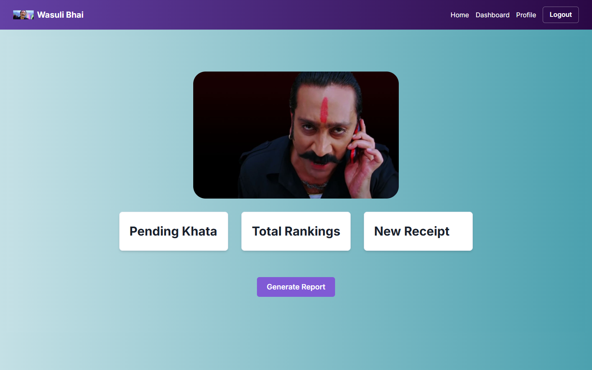
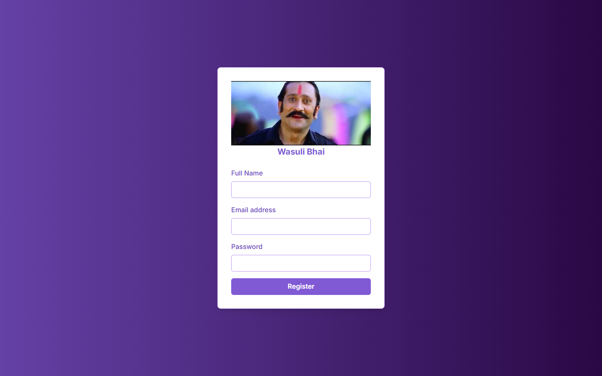

# Wasuli Bhai

The web app for **American System**, a social network for settling money between friends. Keep a running *khata* (ledger) with each person, send them receipts for what they owe, and see who pays up in the rankings.

**Live:** [wasuli.umarkhatana.com](https://wasuli.umarkhatana.com)



## What's in it

- **Sign in and register.** Account screens for joining the network.
- **Dashboard.** The three things you come back for:
  - **Pending Khata:** what's still open with each person.
  - **Total Rankings:** how reliably everyone settles, from *Nawab Sahib* at the top to *Naya Murga* for newcomers.
  - **New Receipt:** bill someone for their share.
- **Reports.** Generate a report of your balances.
- **Connections.** Find and add the people you share expenses with.

| Sign in | Register |
|---|---|
|  |  |

## How it fits together

The app is the front end of American System. The backend (Express, MongoDB, JWT) keeps a *tab* between every pair of friends with what each side owes, and moves each receipt through its lifecycle: sent, then accepted or rejected, and pardoned if the sender lets it go. How people handle their receipts feeds a credit score and a status tier, which is what the rankings show.

## Tech

Next.js 14 (App Router) · TypeScript · Chakra UI · Framer Motion · Tailwind CSS

## Run it

```bash
npm install
npm run dev        # http://localhost:3000
```

The live site is a static export served from Cloudflare.
