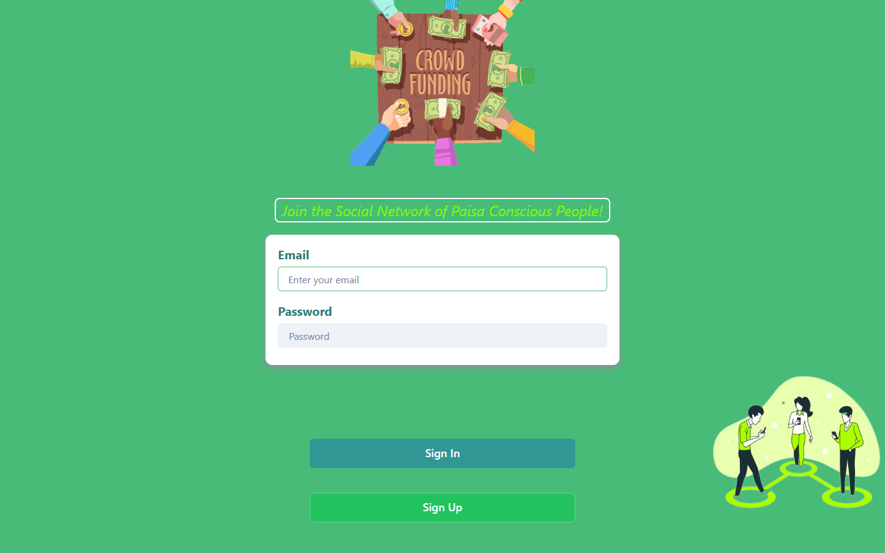
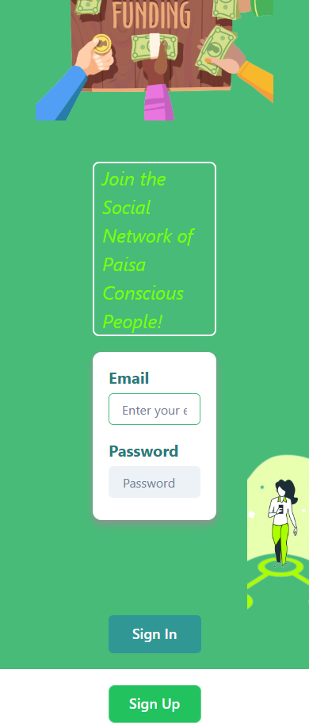

# American System: web

The sign-in experience for **American System**, "the social network of paisa-conscious people": friends keep a running tab with each other, send receipts for what they owe, and build a reputation for paying up.

| Desktop | Mobile |
|---|---|
|  |  |

## What it does

- **Sign in and sign up**, styled with Chakra UI and Tailwind, with illustrations and a layout that works from phones to desktops.
- **Sign-in form** that posts the user's credentials to the login endpoint to start a session.

The API, with tabs, receipts and credit scores, lives in [American_System_Backend_V2](https://github.com/0xWick/American_System_Backend_V2). The full dashboard is [Wasuli Bhai](https://wasuli.umarkhatana.com).

## Tech

Next.js 13 · React 18 · Chakra UI · Framer Motion · Tailwind CSS

## Run it

```bash
npm install
npm run dev        # http://localhost:3000
```
