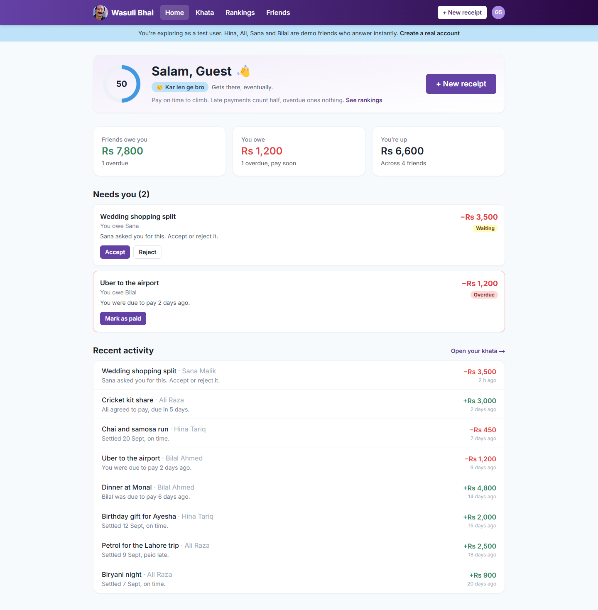
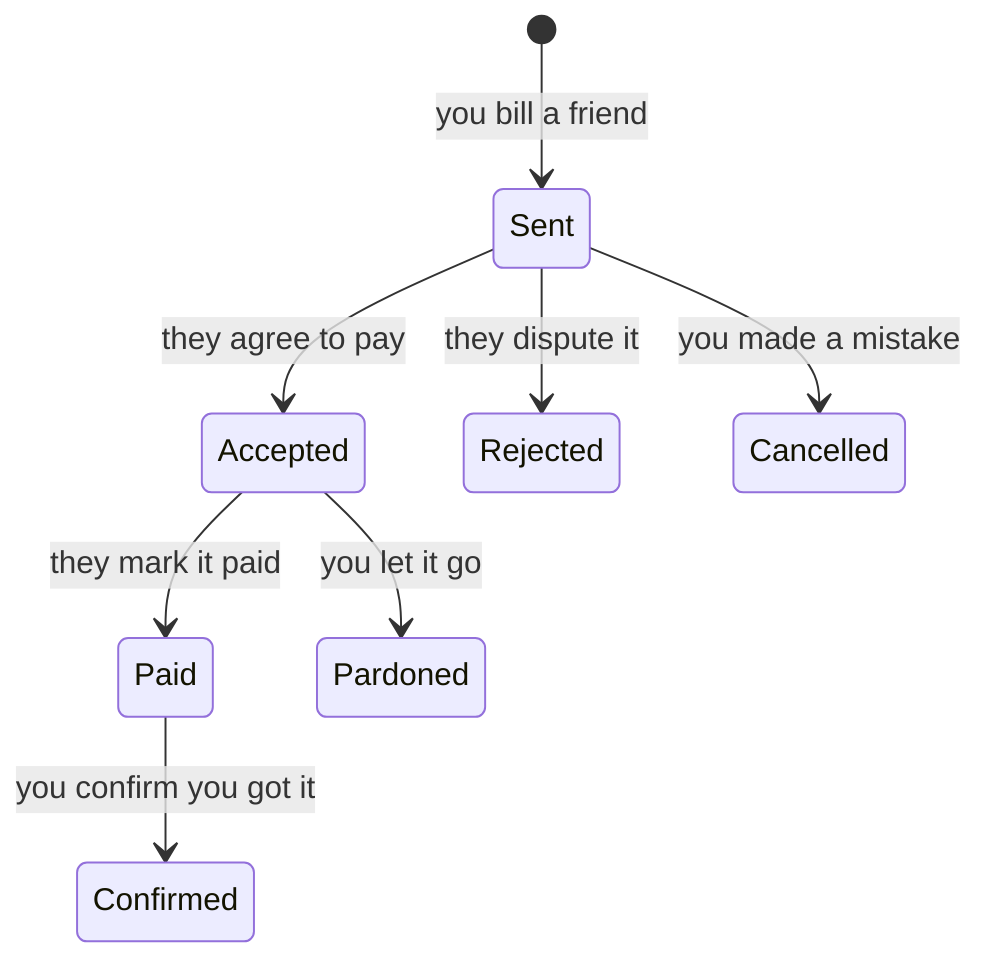
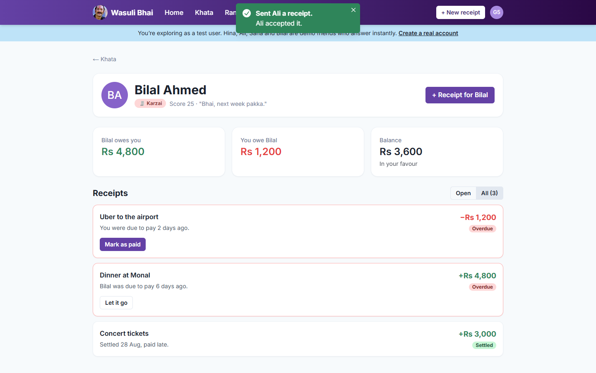
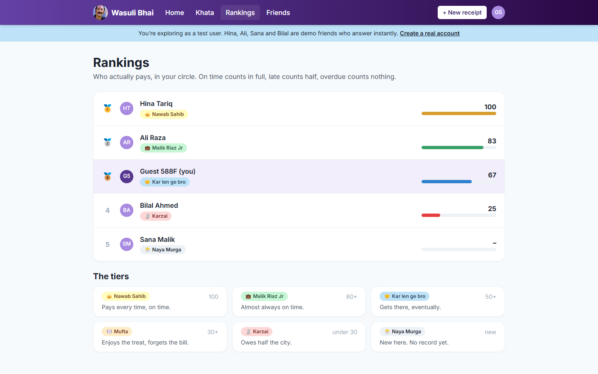
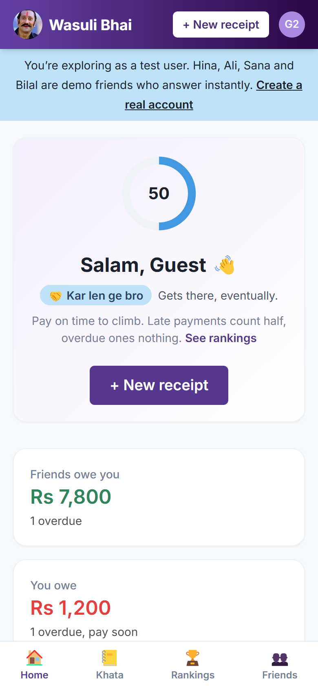
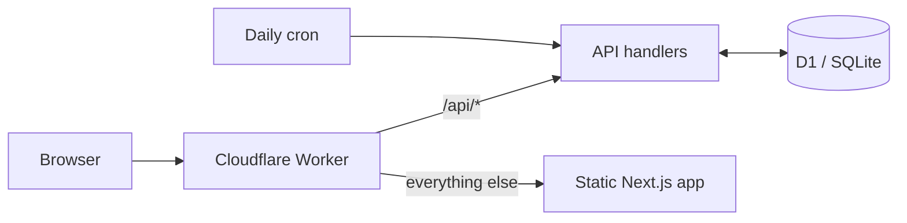

# American System

A social network for settling money between friends. Keep a khata (ledger) with every friend, send receipts for what they owe, and let a public reputation do the asking. The app is **Wasuli Bhai**.

**Live:** [wasuli.umarkhatana.com](https://wasuli.umarkhatana.com). Click **Try it as a test user** and you're in: no sign-up, four demo friends and a few weeks of history.



## How it works

**Tabs.** Every pair of friends shares one tab, which tracks what each side owes the other.

**Receipts.** Paid for dinner? Send a receipt for their share with a due date. Every receipt moves through a lifecycle, and only the right person can move it:



**Reputation.** A debt paid by its due date counts in full, a late one counts half, and one that's overdue and unpaid counts nothing. The score out of 100 puts everyone in a tier their friends can see:

| Tier | Score |
|---|---|
| 👑 Nawab Sahib | 100 |
| 💼 Malik Riaz Jr | 80+ |
| 🤝 Kar len ge bro | 50+ |
| 🍽️ Mufta | 30+ |
| 🧾 Karzai | under 30 |
| 🐣 Naya Murga | no record yet |

**Test users.** One click creates a fresh account with four demo friends, each with their own habits. Hina always pays on time, Ali almost always does, Sana is new, and Bilal is always "next week pakka" and turns down anything over Rs 5,000. They answer your receipts instantly and confirm your payments. Test users and their friends are cleared after a day.

| A friend's tab | Rankings | Mobile |
|---|---|---|
|  |  |  |

## Architecture



One Worker serves both halves. `/api/*` runs the API; every other path is the Next.js app, exported as static files.

| Folder | |
|---|---|
| [`api/`](api) | The API on Cloudflare Workers and D1. Users, tabs, receipts and rankings; PBKDF2 password hashing and HS256 JWTs on Web Crypto; rate-limited test users; a daily cleanup cron. |
| [`api/migrations/`](api/migrations) | The D1 schema, with foreign keys and cascades. |
| [`app/`](app) | Wasuli Bhai: Next.js 14 (App Router, static export) with Chakra UI. Landing page, dashboard, khata, per-friend tabs, rankings, friends and profile, built for desktop and mobile. |

The API keeps the route shape of the first version, which was Express and MongoDB (it's in this repo's history): `POST /api/users`, `POST /api/users/login`, `GET /api/tabs/getAllTabsByUsers`, `POST /api/receipts/send`, `PUT /api/receipts/accept/:id` and so on, plus `POST /api/demo` for test users, `GET /api/dashboard` and `GET /api/rankings`.

## Run it

```bash
cd app && npm install && npm run build      # the app, into app/out
cd ../api && npm install
echo "JWT_SECRET=$(openssl rand -hex 32)" > .dev.vars
npm run dev                                  # applies migrations locally, serves http://localhost:8787
```

## Tests

```bash
cd api
npm test                                     # scoring and tiers
API_URL=http://localhost:8787 npm run smoke  # 28 checks through the whole API
```

The smoke test plays a test user end to end (accept, pay, pardon, the demo friends' replies, the score moving from 50 to 83), then two real accounts through the full receipt lifecycle, and checks that nobody can act on or read what isn't theirs.

## Deploy

```bash
cd api
npx wrangler secret put JWT_SECRET    # once
npm run deploy                        # builds the app, applies migrations, deploys the Worker
```
