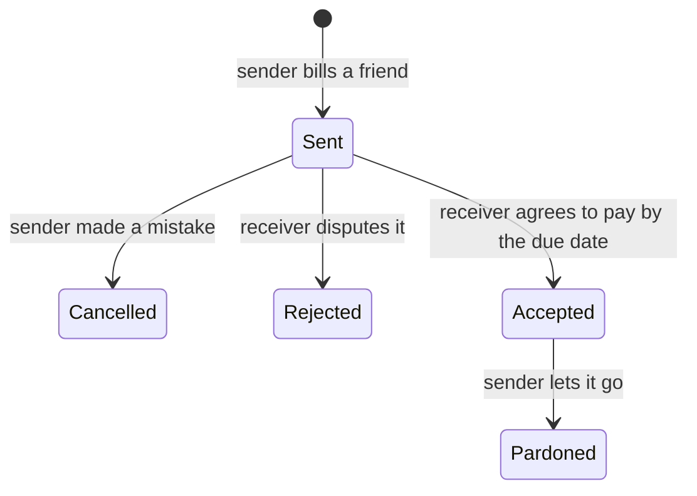

# American System: API

The backend for **American System**, a social network for settling money between friends. "Going American" means everyone pays their own share, and this API keeps score: a running tab between every pair of friends, receipts that move through a clear lifecycle, and a credit score that shows who actually pays.

The web app is [Wasuli Bhai](https://wasuli.umarkhatana.com).

## How it works

**Tabs.** A tab links two people and tracks what each side owes the other (`amountOwedByA`, `amountOwedByB`), with every receipt either of them has sent. It also records when it was last checked for overdue receipts.

**Receipts.** Anyone can bill a friend with a title, a description and an amount. Each receipt moves through a lifecycle, and every stage is timestamped:



**Reputation.** Every user has a credit score and a status tier that follows how they handle their receipts:

| Tier | Score |
|---|---|
| Nawab Sahib | 100% |
| Malik Riaz Jr | 80% and above |
| Kar len ge bro | around 60% |
| Mufta | below 50% |
| Karzai | below 30% |
| Naya Murga | new to the network |

## API

| Method | Path | |
|---|---|---|
| `POST` | `/api/users` | Sign up (password hashed with bcrypt) |
| `POST` | `/api/users/login` | Sign in; returns a JWT |
| `GET` | `/api/users/profile` | The signed-in user |
| `POST` | `/api/users/exists` | Look a user up by email, to start a tab |
| `GET`, `PUT`, `DELETE` | `/api/users/:id` | Read, update or delete a user |
| `POST` | `/api/tabs/createTab` | Open a tab between two users |
| `GET` | `/api/tabs/getAllTabsByUsers` | Every tab a user is part of |
| `GET` | `/api/tabs/:tabId` | One tab, with balances and receipts |
| `POST` | `/api/receipts/send` | Send a receipt |
| `PUT` | `/api/receipts/accept/:id`, `reject/:id`, `cancel/:id`, `pardon/:id` | Move a receipt through its lifecycle |
| `GET` | `/api/receipts/getReceipts`, `/api/receipts/:receiptId` | A user's receipts, or one receipt |

## Structure

```
index.js            Express app, CORS, routes
config/             MongoDB connection
middleware/         JWT auth
models/             User, Tab, Receipt (Mongoose)
controllers/        userController, tabController, receiptController, and the lifecycle actions
routes/             userRoutes, tabRoutes, receiptRoutes
```

## Tech

Node.js · Express · MongoDB with Mongoose · JWT · bcrypt · deployed as a Vercel serverless function

## Run it

```bash
cp .env.example .env     # MONGO_URI_ATLAS or MONGO_URI_LOCAL, JWT_SECRET, PORT
npm install
npm run dev              # http://localhost:8001
```
